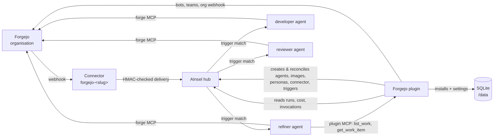

# Architecture

Two halves live in one binary. The **read half** answers "what did AInsel do on
Forgejo" — it asks the hub about runs and builds links back to the forge. The
**write half** is the setup engine — it creates and maintains the trio and
everything they need, in both Forgejo and AInsel.

## The read path

A run's subject — the issue or pull request it was about — is what makes the work
view a work view. It comes from the webhook event that triggered the run, and the
plugin reads it from the hub's invocation record. Nothing in the plugin stores run
data: every read goes to the hub, as the caller, so what a caller sees is what that
caller's credential lets the hub show.

The work view's grouping rules (which pull request belongs to which issue, what
counts as needing attention) are documented in [Work View](work-view).

Links back to Forgejo are built from the address the *install* was created against,
not from a single global setting: two installs on two forges produce links to two
forges.

## The write path

The wizard is the only writer of an install's resources, and it writes as the
plugin's own identity. That matters because every AInsel resource it creates is
stamped `managedBy: plugin-forgejo` at birth: the hub then refuses console writes
of them with 409, and admits only the named manager. One owner, one path in.

Two gaps the hub leaves today, both honest ones:

- **Triggers carry no stamp.** The six event triggers and the patrol cron trigger
  stay console-editable even though their connector is not. Deleting one leaves an
  install quietly incomplete — change triggers through the wizard.
- **The stamp is set at birth only.** Nothing can move `managedBy`, so installs
  created before stamping shipped stay console-managed until they are removed and
  re-created.

## What an install is

An install is keyed by its slug and holds the ids of everything the wizard created:
the three bot logins, the MCP server row, the connector, the images, personas and
agents, the exclude label, the three tool sets, when the webhook was last verified,
and which event families have arrived. The triggers are the exception — they are
recognised by their slug-derived names rather than stored. **The row holds no
secret.**

Every name is derived, so two installs cannot collide, and so an operator can read a
name and know who made it:

| Where | Name | |
|---|---|---|
| Forgejo | `<role>-<slug>` | the role's bot account |
| Forgejo | `ainsel-<role>-<slug>` | the bot's team |
| AInsel | `forgejo-mcp-<slug>` | the forge MCP server row |
| AInsel | `forgejo-<role>-<slug>` | the role's image, persona and agent (three resources, one name, three kinds) |
| AInsel | `forgejo-<slug>` | the connector |
| AInsel | `forgejo-<role>-<what>-<slug>` | the six event triggers, and `forgejo-developer-pr-patrol-<slug>` |

The full table, with what each resource carries, is in
[Setup Wizard](setup#what-one-install-creates).

## State on disk

The pod runs with a read-only root filesystem; `/data` is the one place it may
write, and it is a SQLite database with two stores on it:

- **the install store** — one row per install, as above;
- **the settings store** — the per-role fields the admin owns (persona text, skill
  text, provider, model, keys, the forge MCP row) and the list of Forgejo
  instances an install may be created against.

The volume is what keeps installs across a restart: lose it and the plugin no
longer knows which resources are its own — which is when the orphan sweep exists.

## Reconciling

The plugin owns what it created, so it re-applies it: a pass reads the managed
resources back, computes the state the settings say they should be in, and writes
the difference. It is **triggered, never scheduled** — once at start, on every
settings save, and on the Settings page's **Check now**. There is no timer.

A pass only compares strings, so **Check now** asks the hub a second question after it:
whether each (provider, model) pair the roles name can actually serve a request. That
one is on demand only — a loop pinging a third-party API every ten minutes adds cost and
flake for a failure no pass can write away. See [Setup → Check now](setup#check-now).

A pass corrects the tool grant on each agent, each agent's image and persona, the
six event triggers, the patrol trigger and the event coverage, and logs each
correction against the install. An install whose group the plugin can no longer act
for is skipped and logged. The pass only ever writes to the resource ids on that
install's own row.

One field is deliberately left alone: a **working-hours window** belongs to whoever
wrote it last, the wizard or the console, and a pass that rewrote it would be a pass
that overwrote one of them.

Because the coverage figures come from this loop, what the wizard and the work view
show can lag a real delivery by up to one pass.

## The manifest

`ainsel-plugin.json` is the contract with the hub: the UI entry and its four pages
and two slots, the API base path, the MCP path and each tool's audience, the skill
the plugin serves, the 15 permissions, and the plugin API level (`pluginApi: 1.1`).
The binary checks at start that the paths the manifest declares are the paths the
server actually mounts, and refuses to start if they are not — a rename that moved
one and not the other would otherwise leave a plugin that starts Ready and answers
nothing.
